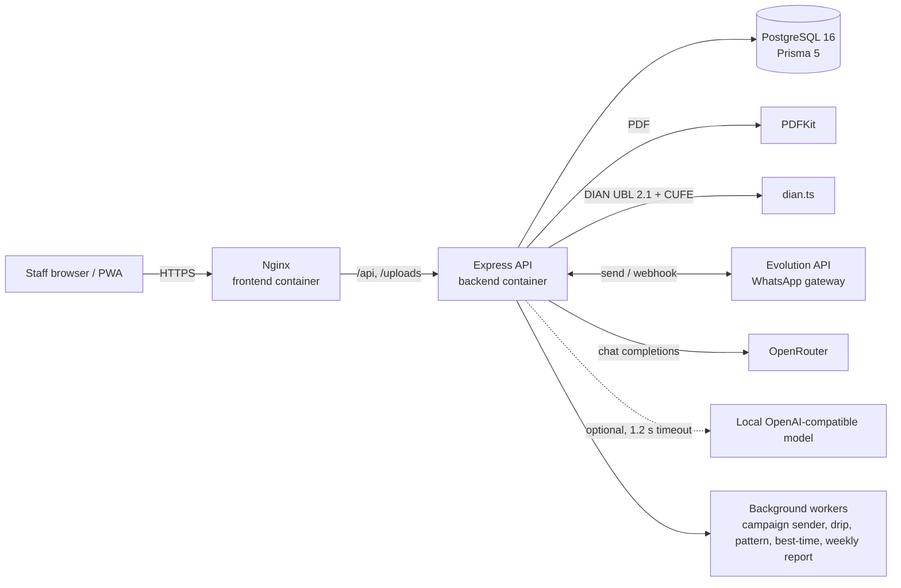

# MARAL OS

**An internal operations platform for a radio-communications equipment distributor: quotes, orders, production, inventory, invoicing, WhatsApp sales and AI-assisted campaigns, in one app.**

MARAL OS replaces spreadsheets and chat threads with a single system of record. Sales builds a quote from the catalog, management approves it, production and logistics follow the order through each stage, and the team talks to clients over WhatsApp from the same screen. A set of AI features drafts campaigns, parses photos and voice notes, suggests replies and classifies inbound leads.

> Built for Maral Tecnología y Comunicaciones S.A.S. (Curití, Santander, Colombia). Personal data and secrets are replaced with placeholders in this copy; see [Status](#status).

---

## What it does

- **Quotes to orders.** Quotation builder with line discounts, PDF output, numbering, and conversion to an order.
- **Order pipeline.** Eight explicit order states, from `CONFIRMADO` to `ENTREGADO`, including partial dispatch and cancellation.
- **Production.** Production orders with phases `BASICO`, `PREENSAMBLE` and `ENSAMBLE_FINAL`, and component-level BOMs.
- **Inventory and purchasing.** Stock movements, suppliers, purchase orders and their items.
- **Electronic invoicing.** DIAN configuration, UBL 2.1 XML generation and CUFE computation (see `backend/src/lib/dian.ts`).
- **WhatsApp inbox.** Chats, media, linked clients and an inbound webhook, through the Evolution API gateway.
- **Campaigns.** Multi-step WhatsApp campaigns with audiences, previews, launch/pause/cancel, drip sequences and metrics.
- **Clients, tags and segments.** CRM records with tags, segment queries and client categories.
- **Tasks, expenses, credit.** Task board with comments, expense tracking (including voice capture), and a credit/factoring status per client.
- **Reports and dashboard.** Management dashboard, reports, and campaign reports.

## AI features

All LLM calls go through OpenRouter, except where noted. Model names are set in code and some are overridable by environment variables.

| Feature | Where | Model / provider |
|---|---|---|
| Daily briefing for the manager | `POST /api/ai/briefing` | OpenRouter, `OPENROUTER_MODEL` (default `google/gemini-2.0-flash-001`) |
| Form autofill suggestions | `POST /api/ai/autofill` | same as above |
| Expense from voice text | `POST /api/ai/parse-expense-voice` | same as above |
| Quotation extracted from a photo | `POST /api/ai/parse-quotation-image` | same as above |
| Reply suggestions and pre-quote from a chat | `POST /api/whatsapp/suggest`, `POST /api/whatsapp/pre-quote` | OpenRouter |
| Lead temperature (`HOT`, `WARM`, `COLD`, `OPTOUT`, `OFFTOPIC`) | `backend/src/lib/lead-classifier.ts` | `anthropic/claude-haiku-4-5` via OpenRouter |
| "Marco" campaign generator and product-photo analysis | `POST /api/campaigns/:id/marco`, `POST /api/campaigns/analyze-photo` | `google/gemini-2.5-flash` via OpenRouter |
| Campaign image generation (templates: promo, comparativa, lanzamiento, testimonial, educativo) | `POST /api/image-gen/...` | `google/gemini-2.5-flash-image-preview` via OpenRouter |
| Brand guard on generated images | `backend/src/lib/brand-guard.ts` | `anthropic/claude-haiku-4-5` via OpenRouter |

Other behaviour:

- **Local-first routing.** `backend/src/routes/ai.ts` first tries an OpenAI-compatible local endpoint (`LOCAL_AI_URL`, 1.2 s timeout) and falls back to OpenRouter.
- **Cost control.** Every AI call is logged in `AIUsageLog`. Image generation checks a monthly budget (`AI_MONTHLY_BUDGET_COP`) and converts USD using `USD_TO_COP_RATE`.
- **Deterministic analytics (no LLM).** A client purchase-propensity score (`purchase-predictor.ts`), monthly analysis of phrases that hurt response rates (`forbidden-patterns.ts`), a best-send-time job (`best-time.ts`), and an A/B experiment registry with a significance test (`experiment-registry.ts`).

## Architecture



## Stack

- **Backend:** Node.js 20, Express 4, TypeScript, Prisma 5, PostgreSQL 16, Zod, JWT (`jsonwebtoken`), bcryptjs, PDFKit, multer.
- **Frontend:** React 18, TypeScript, Vite 5, Tailwind CSS 3, React Router 6, TanStack Query, Zustand, Recharts, jsPDF, PWA service worker.
- **Ops:** Docker Compose (`postgres`, `backend`, `frontend`), Nginx reverse proxy, Windows dev script (`dev.bat`).

## Repository structure

```
.
├── backend/            Express + Prisma API (routes, lib, jobs, schema, seeds)
│   ├── prisma/         schema.prisma, migrations, seed and maintenance scripts
│   ├── scripts/        Python maintenance helpers (data backfill)
│   └── src/            routes/, lib/, middleware/, jobs/
├── frontend/           React SPA (pages, components, store, PWA)
├── desktop/            Small Windows launcher and installer sources (C#)
├── docs/               Architecture, ADRs, module specs, sales doctrine, guides
├── odd/                Feature task specs (Organic Driven Development)
├── scripts/            Top-level data recovery and guide generation scripts
├── docker-compose.yml  postgres + backend + frontend
└── dev.bat             Starts backend and frontend in dev mode (Windows)
```

## Run it

**Docker (recommended for a single host):**

```bash
cp .env.example .env          # set POSTGRES_PASSWORD and JWT_SECRET
docker compose up --build
# frontend: http://localhost  backend: http://localhost:3001
```

**Local development (Windows, PostgreSQL required):**

```bash
cd backend && npm install
cp .env.example .env          # DATABASE_URL, JWT_SECRET, COMPANY_* values
npx prisma generate && npx prisma db push
npm run db:seed               # optional demo data
npm run dev                   # http://localhost:3001

cd ../frontend && npm install && npm run dev   # http://localhost:5173
```

Important variables (see `.env.example` and `backend/.env.example`):

| Variable | Purpose |
|---|---|
| `DATABASE_URL` | PostgreSQL connection string |
| `JWT_SECRET` | Signs session tokens. Must be set in production. |
| `OPENROUTER_API_KEY` | Enables all cloud AI features |
| `OPENROUTER_MODEL`, `LOCAL_AI_URL` | Override the default text model and the local endpoint |
| `EVOLUTION_API_KEY`, `EVOLUTION_WEBHOOK_SECRET` | WhatsApp gateway |
| `SEED_PASSWORD` | Password used by seed scripts (defaults to `change-me`, change it) |
| `STARTUP_SEED_ENABLED`, `BACKGROUND_JOBS_ENABLED` | Disable seeding or workers at boot |
| `COMPANY_*`, `COMPANY_LOGO_PATH` | Company data printed on quotes and shipping labels |

Tests: `backend/src/lib/quotationPolicy.test.ts`, `backend/src/lib/startupPolicy.test.ts`, `backend/src/routes/quotations.test.ts`. There is no `test` script in `package.json` yet; run them with your Node test runner of choice.

## Status

- **Consolidated repository.** This repo consolidates the former private `maral-os` project. Its full development history lives in that private, archived repository and is intentionally not imported here, because it contains secrets and personal data. This tree is the sanitized, current state of the work (it already includes the latest operational-readiness changes).
- **In active development.** The `docs/` and `odd/` folders hold the sprint, handoff and decision history.
- **Schema management:** the repository contains a single Prisma migration. Development uses `prisma db push`, and the `db:push` script passes `--accept-data-loss`. Do not run it against data you care about. A full migration baseline is not in place yet.
- **Known issue, client-side AI key:** `frontend/src/components/ChatBot.tsx` reads `VITE_GEMINI_API_KEY` at build time and sends it in the request URL from the browser. Anything in `VITE_*` ends up in the public bundle. Move that call behind the backend before exposing the app publicly.
- **Competitor tracking:** `backend/src/lib/syscomScraper.ts` reads public product data from a competitor's catalog for price comparison.
- **Secrets and personal data** were removed from this copy. Seeds and scripts use placeholders such as `change-me`, and the DIAN and WhatsApp integrations read their secrets from environment variables.

See [`docs/ROADMAP.md`](docs/ROADMAP.md) and [`docs/PROJECT_MASTER.md`](docs/PROJECT_MASTER.md) for the plan.

## License

Not specified yet. All rights reserved by the owner until a license is added.
